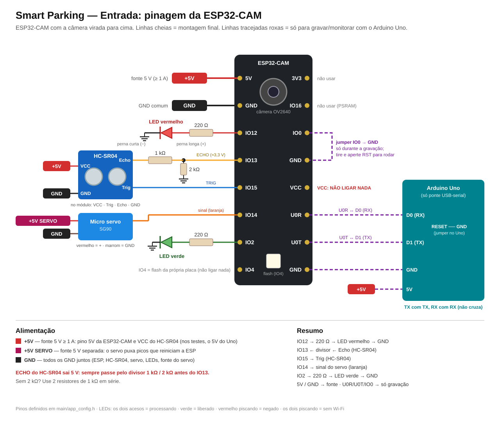

# ESP32-CAM — Entrada (sensor + câmera + cancela) · ESP-IDF

Nó da entrada do estacionamento: detecta o carro com o HC-SR04, fotografa a placa,
envia o JPEG ao servidor e abre a cancela (servo) só quando o servidor libera.

```
carro chega ──► HC-SR04 confirma presença (mediana + 800 ms)
            ──► flash + foto (SVGA, JPEG q=10)
            ──► POST /plates/recognize (API do time, multipart "image")
            ──► success=true     → LED verde, abre cancela (entrada ou saída paga)
                                   carro sai do sensor + 2 s → fecha
            ──► success=false    → placa não lida: LED vermelho, nova foto em 3 s (máx. 3)
            ──► 400 (sem saldo)  → LED vermelho, cancela fechada
                                   só rearma depois que o carro sair
```

## Estrutura

| Arquivo | O quê |
|---|---|
| `main/main.c` | máquina de estados, presença, LEDs, console serial |
| `main/camera_ctl.c` | init da OV2640 + captura com flash |
| `main/servo.c` | servo via LEDC (timer 2, para não brigar com a câmera) |
| `main/ultrasonic.c` | leitura do HC-SR04 |
| `main/wifi.c` | Wi-Fi STA com reconexão automática e rede reserva |
| `main/gate_api.c` | upload multipart para a API + leitura da resposta |
| `main/web.c` | página da câmera, botões da cancela e `/config` |
| `main/settings.c` | URL e calibração do servo salvas na NVS |
| `main/app_config.h` | pinos, limiares, ângulos, câmera |
| `main/Kconfig.projbuild` | Wi-Fi, URL, ID e liga/desliga sensor (via menuconfig) |
| `main/idf_component.yml` | dependência `espressif/esp32-camera` (baixada no 1º build) |
| `sdkconfig.defaults` | PSRAM, 4 MB flash, partição grande, tick 1 ms |
| `tools/mock_server.py` | imita a API do time (sem Postgres/OCR) para testar |
| `docs/` | diagrama de pinagem e placas de teste para imprimir |

O `sdkconfig` gerado guarda a senha do Wi-Fi, por isso **não vai para o Git**.

## 1. Terminar a instalação do ESP-IDF no VS Code

1. `Ctrl+Shift+P` → **ESP-IDF: Configure ESP-IDF Extension** (ou *Open ESP-IDF Installation Manager*).
2. Escolha **Express**, a versão estável mais recente (testado com v6.1) e deixe instalar
   (baixa ~1–2 GB para `C:\Espressif`).
3. Feche e reabra o VS Code.

## 2. Abrir e configurar o projeto

1. **File → Open Folder** → abra **esta pasta** (`hardware/esp32-cam-gate`), não a raiz do repositório.
2. Barra azul de baixo (ou `Ctrl+Shift+P`):
   - **Set Espressif Device Target** → `esp32` (se pedir o tipo de conexão, escolha a opção via USB/UART).
   - **Select Port to Use** → a COM do Arduino Uno.
   - **Select Flash Method** → `UART`.
3. **SDK Configuration Editor** (ícone de engrenagem) → seção **Smart Parking - Entrada**:
   - Wi-Fi SSID / senha (rede **2,4 GHz**) e, opcional, uma rede reserva
   - URL do servidor (IP do PC da API, ex.: `http://192.168.0.10:8000/plates/recognize`)
   - *Usar sensor HC-SR04*: deixe desmarcado até o sensor chegar.
   - Clique em **Save**.
4. Velocidade de gravação via Uno: `Ctrl+Shift+P` → *Preferences: Open Settings (UI)* →
   pesquise `idf.flashBaudRate` → **115200** (o padrão 460800 costuma falhar pelo Uno).

## 3. Ligações para gravar com o Arduino Uno

| Arduino Uno | ESP32-CAM |
|---|---|
| 5V | 5V (esquerdo, 1º pino) |
| GND | GND (esquerdo, 2º pino) |
| D0 (RX) | U0R (direito, 6º pino) |
| D1 (TX) | U0T (direito, 7º pino) |
| RESET → GND do Uno | — |
| — | **IO0 → GND** (direito, 3º e 4º pinos) |

TX com TX e RX com RX (o Uno vira só um conversor USB-serial). **Não ligue nada no VCC** da ESP32-CAM.

## 4. Compilar, gravar e monitorar

1. **Build** (ícone de chave inglesa). O 1º build demora: baixa o componente da câmera.
   O **Flash** não recompila: depois de mudar código ou menuconfig, sempre Build antes.
2. Feche o Monitor (`Ctrl+]`) — senão a COM fica ocupada ("Acesso negado").
3. Com o **IO0 no GND**, tire e recoloque o fio **5V** da ESP (reinicia em modo gravação;
   o botão RST fica embaixo da placa) e clique em **Flash** (raio).
   Se ficar em `Connecting....___`, tire e recoloque o 5V de novo.
4. Tire o **IO0 do GND**, tire e recoloque o **5V** e clique em **Monitor** (ícone de tela).

`Write timeout` / `No serial data received`: desconecte o servo do 5V do Uno,
desconecte e reconecte o USB do Uno e confira o RESET→GND do Uno.

Pelo terminal ESP-IDF é o mesmo:

```bash
idf.py set-target esp32
```

```bash
idf.py menuconfig
```

```bash
idf.py -p COM6 -b 115200 build flash monitor
```

## Ver a câmera no navegador

Depois de conectar no Wi-Fi o monitor mostra `câmera no navegador: http://<ip>/`.
Abra esse endereço no PC ou celular (mesma rede):

- **Nova foto** / **Baixar**: tira e salva uma foto (`/capture` devolve só o JPEG).
- **Abrir / Fechar cancela**: testa o servo sem o monitor serial.
- **Configurar** (`/config`): URL do servidor, tempo de giro e sentido do servo 360°.
  Fica salvo na placa (NVS) — **não precisa Build/Flash para mudar isso**.
  O valor do menuconfig só vale enquanto nada foi salvo pela página.

## Servo 360° (rotação contínua)

Com `SERVO_CONTINUOUS 1` (padrão) o servo gira por `SERVO_MOVE_MS` e depois o
sinal é cortado (sem pulso ele para). Para calibrar no monitor:

- `o` abre, `c` fecha. Se abrir para o lado errado, troque `SERVO_OPEN_DIR` para `-1`.
- `+` / `-` aumenta / diminui o tempo de giro em 50 ms até a cancela ir de 0° a ~90°.
  O valor já fica salvo na placa (ou ajuste em `http://<ip>/config`).

Com um SG90 comum de 180°, use `SERVO_CONTINUOUS 0` e ajuste os ângulos.

## Roteiro de teste (sem sensor)

1. **Só a placa:** grave e abra o monitor. Deve aparecer `cam: ok` e `wifi: conectado ... IP`.
2. **Servo, sem servidor:** `o` / `c` no monitor ou os botões da página.
3. **Enquadramento:** imprima `docs/placa-teste.pdf` (100%) e use **Nova foto** na página.
4. **Fluxo com o servidor de teste** (`--mode allow`, porta 8080; URL em `/config`:
   `http://IP-DO-PC:8080/plates/recognize`): `p` → foto → `tipo=entrada`, cancela abre →
   `x` → fecha. Repita `p`/`x`: agora `tipo=saida` (cobra a permanência).
5. **Placa não lida:** `--mode deny` → LED vermelho, 3 fotos, cancela fechada. `x` rearma.
6. **Sem saldo:** `--saldo 0`, faça a entrada, espere ~10 s e faça a saída → 400, vermelho.
7. **Servidor fora:** pare o servidor e digite `p`: termina em ERRO, cancela fechada.
8. **API real:** troque a URL em `/config` para a API do time (seção abaixo).

## Testando sem o sensor ultrassônico

Com o sensor desmarcado no menuconfig, digite no monitor:

| Tecla | Efeito |
|---|---|
| `p` | carro chegou → foto + envio |
| `x` | carro saiu → cancela fecha 2 s depois |
| `o` / `c` | abre / fecha a cancela (calibrar ângulos) |
| `f` | foto + envio sem mexer na cancela |
| `d` | mede distância no HC-SR04 |
| `s` | status (estado, Wi-Fi, memória) |

No PC (mesma rede da ESP):

```bash
python hardware/esp32-cam-gate/tools/mock_server.py --mode allow --port 8080
```

Modos: `allow` (reconhece `--fake-plate`, padrão SPK2A26), `deny` (não reconhece),
`full` (400 "Estacionamento lotado") e `ocr` (YOLO + OCR do repositório; precisa das
dependências de `backend/api/requirements.txt`). `--saldo` muda o saldo inicial.
As fotos recebidas ficam em `tools/captures/`; `GET /plates` mostra placas e saldos.

## Integração com a API do time (`backend/api`)

A ESP envia exatamente o que a API espera:

`POST /plates/recognize` — `multipart/form-data`, campo **`image`** (`placa.jpg`, `image/jpeg`),
headers extras `X-Device-Id` e `X-Api-Key` (opcional, ignorados pela API).

| Resposta da API | O que a ESP faz |
|---|---|
| `200 {"success": true, "plate", "saldo", "tipo"}` | abre a cancela (entrada ou saída paga) |
| `200 {"success": false, "plate": null}` | placa não lida: vermelho, nova foto em 3 s (máx. 3) |
| `400 {"detail": "Saldo insuficiente ..."}` | negado: vermelho, cancela fechada |
| outro código / sem resposta | erro: cancela fechada |

**Sem envio duplicado:** a API registra entrada/saída a cada reconhecimento, então a ESP
só repete o envio se a conexão falhar *antes* de a foto ir inteira. Timeout de resposta: 30 s
(o 1º reconhecimento carrega o OCR e demora).

Para a ESP alcançar a API, ela precisa escutar na rede (não só em 127.0.0.1). Em `backend`:

```bash
uvicorn api.main:app --host 0.0.0.0 --port 8000
```

E em `http://<ip-da-esp>/config`: `http://IP-DO-PC:8000/plates/recognize`.
Se a porta 8000 já estiver em uso no PC (ex.: outro container Docker), use `--port 8001`.

## Ligações finais (com sensor e servo)

| Componente | Pino ESP32-CAM | Observação |
|---|---|---|
| Servo sinal | GPIO 14 | V+ em **fonte 5 V separada**, GNDs unidos |
| HC-SR04 TRIG | GPIO 15 | |
| HC-SR04 ECHO | GPIO 13 | **divisor**: ECHO─1 kΩ─GPIO13─2 kΩ─GND (ECHO é 5 V) |
| HC-SR04 VCC | 5 V | |
| LED vermelho | GPIO 12 → 220 Ω → perna longa; perna curta → GND | |
| LED verde | GPIO 2 → 220 Ω → perna longa; perna curta → GND | |
| Flash | GPIO 4 | LED branco da própria placa |



A câmera ocupa quase todos os pinos; os livres (2, 4, 12, 13, 14, 15) são do
cartão SD — por isso o SD não é usado.

LEDs: os dois acesos = processando · verde = liberado · vermelho piscando = negado ·
os dois piscando juntos = sem Wi-Fi.

## Checklist

- [x] Leitura de distância, mediana e limiar com tempo de confirmação
- [x] Sem disparos repetidos: rearma só depois que a área fica livre
- [x] Foto: SVGA, JPEG 10, flash, descarte de frames velhos
- [x] Upload multipart para `/plates/recognize` sem envio duplicado; em falha a cancela fica fechada
- [x] Servo abre só com `success: true`; fecha após passagem ou 60 s
- [x] Wi-Fi com reconexão automática; os dois LEDs piscam quando offline
- [x] Build e gravação com ESP-IDF 6.1
- [ ] Teste ponta a ponta com a API real + Postgres
- [ ] Calibrar o servo na maquete (batente físico + tempo de giro)
- [ ] Ajustar `PRESENCE_CM` e posição/foco da câmera com o sensor real
